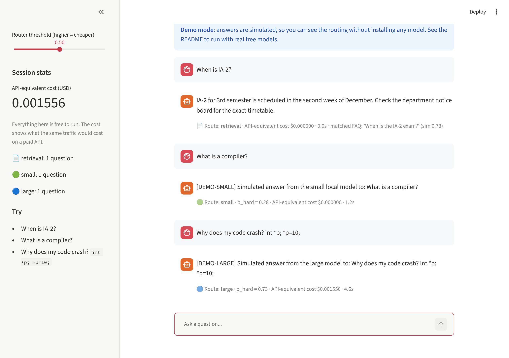
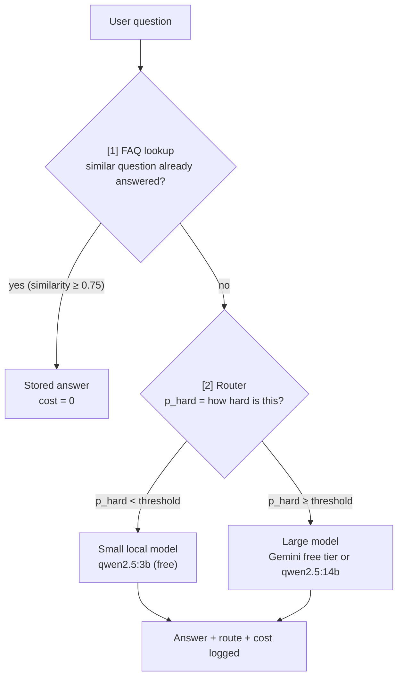
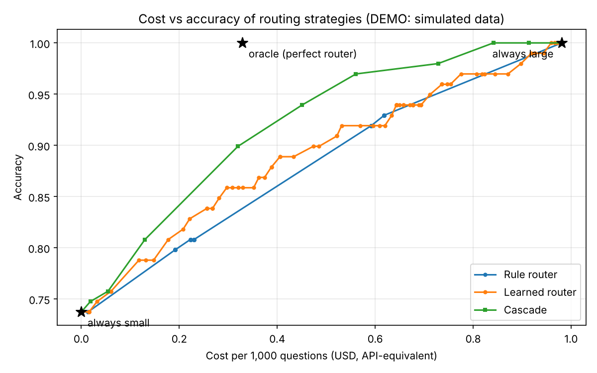

# 🔀 Smart Model Router

[](https://github.com/Zhussain13/SmartModelRouter/actions/workflows/ci.yml)


**Send each question to the cheapest AI that can still answer it correctly.**

Smart Model Router is a student-help chatbot that decides, *for every question*, whether to
answer it from **stored FAQs**, a **small local model**, or a **large model**. It also measures
how close each routing strategy gets to large-model accuracy and how much it would cost.

Everything uses **free models only**: Qwen 2.5 runs locally through [Ollama](https://ollama.com),
and the large model is either Google Gemini on its **free tier** or a **bigger local Qwen**. There
is also a **demo mode** that runs the whole project with no models, keys or downloads.

<p align="center">
  
</p>

---

## Contents

- [Why](#why)
- [How it works](#how-it-works)
- [Quick start (demo mode, 2 minutes)](#quick-start-demo-mode-2-minutes)
- [Full setup with real free models](#full-setup-with-real-free-models)
- [Running the pipeline](#running-the-pipeline)
- [Results](#results)
- [Project structure](#project-structure)
- [Configuration](#configuration)
- [Troubleshooting](#troubleshooting)
- [Documentation](#documentation)
- [References](#references)

---

## Why

| Option | Quality | Cost | Speed |
|---|---|---|---|
| **Large model** (Gemini, GPT, Claude, Qwen 14B) | Excellent | Paid APIs charge per token; local runs need a big machine | Slower |
| **Small local model** (Qwen 2.5 3B, Llama 3.2 3B) | Good on easy questions, weak on hard ones | Free, runs on a laptop | Fast |

Most student questions are easy ("What is a pointer?"), and a free 3B model answers them just as
well as a large model. Some questions need no AI at all ("When is the IA-2 exam?"). Only the hard
ones ("Why does my linked-list code segfault?") really need the large model.

> **Problem statement:** for each incoming question, automatically decide whether to answer from
> stored documents, a small model or a large model, so that accuracy stays close to the large
> model's while the cost stays as low as possible.

## How it works



| Route | Example question | Why |
|---|---|---|
| 📄 **Retrieval** | "When is the IA-2 exam?" | The answer is already in `data/faq.csv`, so no AI is needed |
| 🟢 **Small model** | "Explain what a pointer is in C." | Textbook knowledge that a 3B model handles well |
| 🔵 **Large model** | "Why does this linked-list code segfault?" + code | Needs multi-step reasoning |

### Three routers, compared

1. **Rule router (baseline):** hand-written signals. Is the question long? Does it contain code? Does it use words like
   *why, debug, prove, derive*? Does it contain arithmetic?
2. **Learned router:** logistic regression on a sentence embedding (MiniLM, 384 numbers) plus two
   hand-made features, trained to predict *"will the small model get this wrong?"*
3. **Cascade router:** always ask the small model first. It reports its confidence (1–10), and if
   that is low, the question goes to the large model.

They are compared with three reference points: **always small**, **always large**, and an **oracle**
(a perfect router that escalates exactly when the small model is wrong and the large model is right).

Training labels come from an **LLM-as-judge**: both models answer every question, and the large
model grades each answer against a reference. Full details are in [docs/ROUTER_DESIGN.md](docs/ROUTER_DESIGN.md).

---

## Quick start (demo mode, 2 minutes)

Demo mode swaps every model for a built-in **simulator**, so you can see the whole system working
before installing anything heavy. It needs Python 3.10+ only.

```bash
git clone https://github.com/Zhussain13/SmartModelRouter.git
```

```bash
cd SmartModelRouter
```

```bash
pip install -r requirements-demo.txt
```

```bash
python run_pipeline.py --demo
```

```bash
streamlit run app.py -- --demo
```

`run_pipeline.py --demo` labels 327 questions, trains the router, and writes the comparison table
and graph to `outputs/demo/`. The app opens at http://localhost:8501.

> ⚠️ Demo answers and numbers are **simulated**. They show how the system behaves, not how real
> models perform. Real results come from the full setup below.

---

## Full setup with real free models

### 1. Install the tools (one time)

1. **Python 3.10+** from https://www.python.org/downloads/ (on Windows, tick *"Add Python to PATH"*).
2. **Ollama** from https://ollama.com/download. On Windows and Mac it runs in the background.
   On Linux, run `ollama serve` in a separate terminal.
3. Download the **small model** (about 2 GB):

   ```bash
   ollama pull qwen2.5:3b
   ```

4. Choose a **free large model**. Option A is the default.

   | | **A. Gemini free tier** (default) | **B. Local Qwen 14B** |
   |---|---|---|
   | Needs | A free API key, internet | About 16 GB RAM, about 9 GB disk |
   | Speed | Fast, but rate-limited | Depends on your PC |
   | Setup | Go to https://aistudio.google.com → **Get API key** → **Create API key**. **Do not enable billing**: without billing the key can never be charged. | `ollama pull qwen2.5:14b` (with 8 GB RAM use `qwen2.5:7b` and set `LARGE_OLLAMA_MODEL=qwen2.5:7b`) |

### 2. Set up the project

```bash
python -m venv venv
```

Activate it on Windows:

```bash
venv\Scripts\activate
```

or on Mac / Linux:

```bash
source venv/bin/activate
```

```bash
pip install -r requirements.txt
```

### 3. Tell it which large model to use (in every new terminal)

| | Windows (PowerShell) | Mac / Linux |
|---|---|---|
| **A. Gemini** | `$env:GEMINI_API_KEY="your-key"` | `export GEMINI_API_KEY="your-key"` |
| **B. Local Qwen** | `$env:LARGE_PROVIDER="ollama"` | `export LARGE_PROVIDER=ollama` |

(In Command Prompt use `set NAME=value`.)

### 4. Check everything works

```bash
python check_setup.py
```

It tests the small model, the large model and the embedding model, and tells you how to fix
anything that fails.

---

## Running the pipeline

| # | Command | What it does |
|---|---|---|
| 0 | `python check_setup.py` | Confirms the models and embeddings work |
| 1 | `python build_labels.py` | Both models answer every question in `data/queries.csv` and the judge grades them. Saves `outputs/real/labels.csv` |
| 2 | `python train_router.py` | Trains the learned router. Saves `outputs/real/router.joblib` and the held-out test split |
| 3 | `python evaluate.py` | Compares all strategies on the test split (no model calls). Saves `results.csv` and `results.png` |
| 4 | `streamlit run app.py` | The chat app, using the trained router (or the rule router if none is trained) |

Steps 1–3 in one command:

```bash
python run_pipeline.py
```

Tips:

- **Try a few questions first** with `python build_labels.py --limit 5`.
- **Labelling resumes.** If it stops (internet drop, quota, Ctrl+C), run it again and it
  continues where it left off.
- **Gemini free-tier quota.** Each question needs 2–3 Gemini calls. The free tier has
  per-minute and per-day limits, so labelling everything may take more than one day; just rerun
  the next day. The code waits between calls and retries automatically on rate-limit errors.
  `JUDGE_MODEL=gemini-2.5-flash-lite` (bigger free quota) speeds this up.

### Multilingual test (Kannada/English code-mixed)

`data/queries_kanglish.csv` has Kanglish questions ("Pointer andre enu?"). They are kept out of
training so you can test how the English-trained router copes with them. First label them:

```bash
python build_labels.py --input data/queries_kanglish.csv --output outputs/real/labels_kanglish.csv
```

Then evaluate on that file:

```bash
python evaluate.py --test outputs/real/labels_kanglish.csv --out outputs/real/results_kanglish
```

---

## Results

### Demo run (simulated data)

These numbers come from `python run_pipeline.py --demo`. **They are simulated** and only show what
the output looks like. Replace them with your real run for any report.

<p align="center">
  
</p>

| Strategy | Accuracy | Cost / 1k questions (USD) | Sent to large |
|---|---|---|---|
| Always small | 73.7% | $0.00 | 0% |
| Always large | 100% | $0.98 | 100% |
| Oracle (perfect router) | 100% | $0.33 | 26% |
| Rules @0.5 | 80.8% | $0.22 | 14% |
| Learned @0.5 | 91.9% | $0.60 | 45% |
| Cascade conf<7 | 97.0% | $0.56 | 41% |

`evaluate.py` also prints the **headline**: the cheapest setting of each router that keeps 95%
of the large model's accuracy. In the demo run, the cascade does that at **57% of the cost** and
the learned router at **75%**.

**How to read the graph:** points toward the **top-left** are best (high accuracy, low cost). The
gap between a router's curve and the oracle star is the room left for improvement.

### Your real results

Run the full pipeline. `outputs/real/results.csv` and `outputs/real/results.png` are the table
and graph for your report.

> "Cost" is **API-equivalent**: what the same traffic would cost on a paid API (Gemini 2.5 Flash
> list price by default). You pay nothing to run this project. The cost column lets the strategies
> be compared fairly.

---

## Project structure

```
SmartModelRouter/
├── config.py             # all settings: models, providers, prices, thresholds, paths
├── models.py             # Ollama / Gemini / demo calls, confidence parsing, LLM-as-judge
├── demo_models.py        # simulator used in demo mode (no models needed)
├── retriever.py          # FAQ lookup with sentence embeddings
├── router.py             # rule router + learned router (p_hard in [0, 1])
├── check_setup.py        # step 0: verify setup
├── build_labels.py       # step 1: answer + grade every question -> labels
├── train_router.py       # step 2: train the learned router
├── evaluate.py           # step 3: compare strategies, draw cost-vs-accuracy graph
├── run_pipeline.py       # steps 1-3 in one command
├── app.py                # step 4: Streamlit chat app
├── data/
│   ├── faq.csv               # FAQ questions + answers (retrieval route)
│   ├── queries.csv           # 327 English questions (C, DS, algorithms, DBMS, OS, CN, OOP, maths)
│   └── queries_kanglish.csv  # Kannada/English code-mixed questions (multilingual test)
├── docs/
│   ├── LITERATURE_SURVEY.md  # related work and research gap
│   ├── ROUTER_DESIGN.md      # how each component and router works
│   ├── DEVELOPMENT_LOG.md    # how the project was built, step by step
│   └── images/
├── tests/                # pytest: routers, model calls (mocked), full demo pipeline
├── outputs/              # generated (git-ignored): outputs/real/ and outputs/demo/
├── requirements.txt      # full install
├── requirements-demo.txt # light install for demo mode
└── requirements-dev.txt  # for running tests
```

## Configuration

All settings are in [`config.py`](config.py). Each one can be overridden with an environment variable:

| Variable | Default | Meaning |
|---|---|---|
| `SMR_DEMO` | `0` | `1` turns on demo mode (same as `--demo`) |
| `SMALL_MODEL` | `qwen2.5:3b` | Small Ollama model (try `qwen2.5:1.5b` on slow PCs) |
| `LARGE_PROVIDER` | `gemini` | `gemini` (free tier) or `ollama` (local) |
| `GEMINI_MODEL` | `gemini-2.5-flash` | Gemini model when the provider is `gemini` |
| `LARGE_OLLAMA_MODEL` | `qwen2.5:14b` | Local large model when the provider is `ollama` |
| `JUDGE_MODEL` | same as the large model | Model used to grade answers |
| `LARGE_PRICE_IN` / `LARGE_PRICE_OUT` | `0.30` / `2.50` | API-equivalent price, USD per 1M tokens (cost analysis only) |
| `RETRIEVAL_THRESHOLD` | `0.75` | FAQ similarity needed to skip the models |
| `API_SLEEP` | `6.0` | Seconds to pause after each Gemini call |
| `OLLAMA_URL` | `http://localhost:11434` | Where Ollama is running |

## Troubleshooting

| Error | Fix |
|---|---|
| `Connection refused ... 11434` | Ollama is not running. Open the Ollama app, or run `ollama serve` |
| `model 'qwen2.5:3b' not found` | `ollama pull qwen2.5:3b` (and `ollama pull qwen2.5:14b` for option B) |
| Gemini `API key not valid` / `PERMISSION_DENIED` | The key isn't set in *this* terminal. Set it again |
| Gemini `404 model not found` | Google renamed the model. Set `GEMINI_MODEL` to a current name from https://ai.google.dev/gemini-api/docs/models |
| `429 RESOURCE_EXHAUSTED` keeps repeating | Daily free quota is used up. Rerun tomorrow (it resumes), or use `JUDGE_MODEL=gemini-2.5-flash-lite` |
| `train_router.py`: "Need at least 3 ..." | Too few labelled questions, or all labels the same. Label more |
| Small or large local model very slow | Use smaller models: `qwen2.5:1.5b` / `qwen2.5:7b` |
| Anything else | `python check_setup.py`, and try `--demo` to confirm the code itself works |

Run the tests with:

```bash
pip install -r requirements-dev.txt
```

```bash
pytest -q
```

## Documentation

- 📚 [Literature survey](docs/LITERATURE_SURVEY.md): routing, cascades, LLM-as-judge, retrieval, code-mixed NLP, and the gap this project addresses
- 🧭 [Router design](docs/ROUTER_DESIGN.md): every component, feature and metric explained
- 📝 [Development log](docs/DEVELOPMENT_LOG.md): how each part was built and tested, and the decisions made

## Ideas to extend

1. **Multilingual routing:** grow `data/queries_kanglish.csv` and compare the router on English vs Kanglish.
2. **Better router model:** fine-tune DistilBERT instead of logistic regression.
3. **Middle tier:** small → medium (e.g. `qwen2.5:7b`) → large.
4. **Semantic cache:** reuse answers to questions that were already asked.
5. **Real student questions:** collect them with a Google Form. This is what makes the dataset original.

## References

- L. Chen, M. Zaharia, J. Zou. *FrugalGPT: How to Use Large Language Models While Reducing Cost and Improving Performance.* 2023. [arXiv:2305.05176](https://arxiv.org/abs/2305.05176)
- I. Ong et al. *RouteLLM: Learning to Route LLMs with Preference Data.* 2024. [arXiv:2406.18665](https://arxiv.org/abs/2406.18665)
- Q. J. Hu et al. *RouterBench: A Benchmark for Multi-LLM Routing System.* 2024. [arXiv:2403.12031](https://arxiv.org/abs/2403.12031)

The full list is in the [literature survey](docs/LITERATURE_SURVEY.md).

## License

[MIT](LICENSE). Free to use, change and share.
