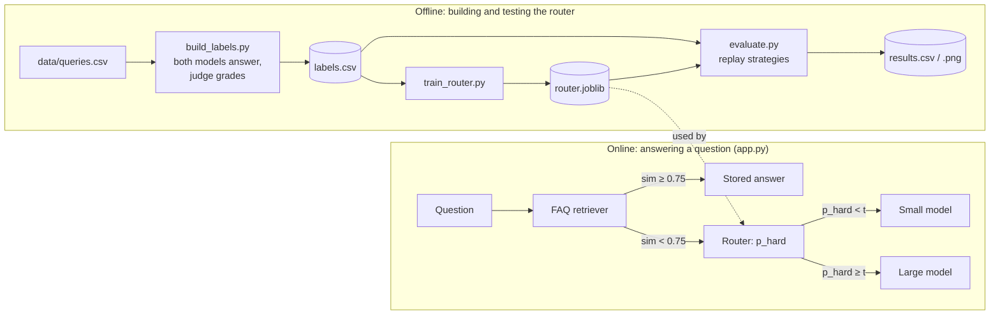

# Router Design

This document explains how every part of Smart Model Router works and why it was built that way.
For setup and usage, see the [README](../README.md).

---

## 1. System overview

An animated, interactive version of this overview is in [architecture.html](architecture.html)
(also as [architecture.gif](images/architecture.gif) and [architecture.mp4](images/architecture.mp4)).



| Component | File | Role |
|---|---|---|
| Configuration | `config.py` | Models, provider, prices, thresholds and paths in one place |
| Model access | `models.py` | One interface (`ask_small`, `ask_large`, `judge`) over Ollama, Gemini or the demo simulator |
| Retriever | `retriever.py` | Embeds FAQ questions and finds the most similar one |
| Routers | `router.py` | Rule router and learned router, each returning `p_hard ∈ [0, 1]` |
| Labelling | `build_labels.py` | Creates the supervised dataset |
| Training | `train_router.py` | Fits the learned router |
| Evaluation | `evaluate.py` | Offline replay of every strategy, graph and headline |
| App | `app.py` | Streamlit chat interface |
| Simulator | `demo_models.py` | Stand-in for all models in demo mode |

---

## 2. Tier 1: FAQ retrieval

1. Every FAQ question is embedded once with `all-MiniLM-L6-v2`, giving a 384-dimensional unit vector.
2. A new question is embedded the same way.
3. Because the vectors have unit length, **cosine similarity = dot product**:
   `sims = faq_vectors @ q`.
4. If the best similarity is **≥ `RETRIEVAL_THRESHOLD` (0.75)**, the stored answer is returned
   at cost $0 and no model is called.

**Choosing the threshold.** If it is too low, questions get wrong FAQ answers (for example, "When
is IA-3?" matching "When is IA-2?"). If it is too high, paraphrases miss the FAQ and cost an LLM
call. 0.75 is a conservative starting point for MiniLM; tune it on real paraphrases. Demo mode uses
a cruder hashing embedder with filler words ("what", "is", "the", …) removed for FAQ lookup. Its
threshold of 0.47 was tuned so that all 14 FAQ phrasings match while none of the 337 course
questions do (highest 0.45).

---

## 3. Tier 2: the routers

Every router outputs `p_hard`, an estimate of how likely the question is to need the large model.
A **threshold `t`** turns it into a decision:

```
p_hard ≥ t  →  large model
p_hard < t  →  small model
```

Moving `t` from 0 to 1 moves the system from "always large" (accurate, expensive) to "always
small" (cheap, less accurate). The app's sidebar slider changes `t` live, and `evaluate.py` sweeps
it to draw each router's curve.

### 3.1 Rule router (baseline)

`rule_score(q)` adds up fixed weights and caps the total at 1.0:

| Signal | Check | Weight |
|---|---|---|
| Long question | more than 40 words | +0.4 |
| Contains code | `{ } ;`, `#include`, `int main`, `def `, `printf(`, `class`, `=>` | +0.4 |
| Reasoning words | why, debug, error, segfault, crash, prove, derive, compare, design, optimi(se), complexity, step by step, analy(se), difference between, trace, output of | +0.3 |
| Arithmetic | pattern like `12 * 4` | +0.2 |

**Strengths:** no training, fully explainable, instant.
**Weaknesses:** brittle. "Explain the difference between TCP and UDP" is scored as hard (+0.3)
although small models answer it well, and a hard question with no trigger words is scored 0. Its
scores are also coarse (only a few distinct values), so its cost-accuracy curve has few points.

### 3.2 Learned router

**What it predicts.** `P(needs_large = 1 | question)`, where `needs_large = 1` means *the small
model's answer was judged wrong*.

**Features (386 numbers per question):**

| Features | Count | Why |
|---|---|---|
| MiniLM sentence embedding | 384 | Captures topic and question type: "define X" and "debug this" end up in different regions |
| `rule_score(q)` | 1 | Gives the model the handcrafted signals directly |
| `min(words, 200) / 200` | 1 | Question length, normalised |

**Model.** Logistic regression (`max_iter=2000`, `class_weight="balanced"`).

- *Why logistic regression?* It trains in under a second on a few hundred examples and outputs
  calibrated-ish probabilities, which is what a threshold needs. It is also easy to explain in a
  report.
- *Why `class_weight="balanced"`?* Usually only 20–35% of questions need the large model. Without
  balancing, the classifier would lean toward predicting "small OK" and miss hard questions, which
  costs accuracy.

**Training procedure (`train_router.py`):**

1. Load `labels.csv`.
2. Stratified 70/30 train/test split (`random_state=42`), so both halves have the same share of
   hard questions.
3. Fit on the training 70%.
4. Report precision, recall and F1 at threshold 0.5, plus **ROC-AUC**, which measures how well
   hard and easy questions are ranked regardless of threshold.
5. Save the model and the 30% test split. **`evaluate.py` uses only that test split**, so the
   learned router is never scored on questions it was trained on.

### 3.3 Cascade router

1. Ask the small model, adding: *"After your answer, write one final line exactly like
   'CONFIDENCE: N' where N is 1-10"*.
2. Parse the **last** `CONFIDENCE: N` (markdown such as `**CONFIDENCE:** 8` is handled, values are
   clamped to 1–10, and a missing value counts as 5). Remove the line from the answer shown to the user.
3. If `confidence < c`, discard the answer and ask the large model.

**Cost accounting.** A cascade *always* pays for the small attempt. Its cost is
`small_cost + (large_cost if escalated)`, and its latency is `small_latency + (large_latency if escalated)`.
Because the small model is free, the cost penalty here is zero, but the **latency penalty is
real**, and `evaluate.py` reports it.

**Strengths:** needs no training data, and the decision is based on the actual answer rather than
just the question.
**Weaknesses:** small models are often over-confident (see Kadavath et al., 2022 in the
[literature survey](LITERATURE_SURVEY.md)), and escalated questions are slower.

### 3.4 Threshold tuning

A fixed threshold of 0.5 is arbitrary. `train_router.py` tunes one threshold per router:

1. Score the **training** questions only. The learned router's scores come from 5-fold
   cross-validation inside the training set, so no question is scored by a model that saw it.
2. Try every threshold (0.00–1.00 in steps of 0.05, or confidence 1–11 for the cascade).
3. Keep the **cheapest** threshold whose accuracy is at least `ACCURACY_TARGET` (95%) of the
   always-large accuracy.
4. If only "send everything to the large model" reaches the target (the rule router often
   can't), keep the default instead, because that isn't routing.
5. Save the results to `tuning.json`. `evaluate.py` reports the tuned settings on the untouched
   test set, and the chat app and live console start from them.

Because the thresholds are chosen on training data, the test accuracy usually lands a little below
the target. That gap is reported honestly instead of tuning on the test set.

---

## 4. Producing labels: LLM-as-judge

For each question in `data/queries.csv`, `build_labels.py`:

1. gets the small model's answer and confidence,
2. gets the large model's answer,
3. asks the judge whether the small answer is correct, comparing it against the human reference
   answer if one exists, otherwise against the large model's answer,
4. if a human reference exists, also judges the large model's answer; if not, the large answer is
   assumed correct.

The judge prompt asks for exactly one word, **YES or NO**, to the question *"Is the candidate
answer correct and complete enough to genuinely help a student?"*

| Column | Meaning |
|---|---|
| `small_ok`, `large_ok` | 1 if the judge said YES |
| `needs_large` | `1 - small_ok` (the router's training target) |
| `small_conf` | Small model's self-reported confidence |
| `small_cost`, `large_cost` | API-equivalent cost of each answer |
| `small_latency`, `large_latency` | Seconds per answer |
| `has_reference` | Whether a human reference answer was available |

**Reliability features:**

- **Resume:** questions already in the output file are skipped, so a crash or quota stop loses nothing.
- **Checkpoints** every 10 questions, and a save on Ctrl+C.
- **Rate limits:** Gemini calls pause `API_SLEEP` seconds and retry with growing waits
  (30 s, 60 s, …) on 429/503 errors.

**Known limitation: self-enhancement bias.** When no human reference exists, the large model
judges its own answer as the reference and is assumed correct. This favours the large model.
Mitigations: add reference answers to `queries.csv`, use a different judge with `JUDGE_MODEL`, or
spot-check about 30 labels by hand and report the agreement.

---

## 5. Evaluation method

`evaluate.py` makes **no model calls**. Because every question was answered and graded by both
models in step 1, any strategy can be *replayed*: for each question, look up whether the chosen
model was right and what it cost. This is the RouterBench approach. It is free, instant and
exactly reproducible.

**Metrics per strategy:**

| Metric | Definition |
|---|---|
| Accuracy | Share of test questions answered correctly by the chosen model |
| Cost per 1k | Sum of API-equivalent costs ÷ N × 1000 |
| % large | Share of questions sent to the large model |
| Average latency | Mean seconds per question (cascade includes both calls when escalating) |

**Strategies:**

| Strategy | Rule |
|---|---|
| Always small / always large | Lower and upper reference points |
| Oracle | Large model only when `small_ok = 0` and `large_ok = 1`: the best any router could do |
| Rules @t, Learned @t | Threshold `t` swept from 0 to 1 (101 steps) to draw the curves |
| Cascade conf<c | Threshold `c` from 1 to 11 |

**Headline.** For each router, the cheapest setting whose accuracy is ≥ 95% of always-large
accuracy, reported as a percentage of always-large cost.

**Reading the graph.** The x-axis is cost and the y-axis is accuracy, so up-and-left is better.
A router is useful if its curve lies **above the straight line** between "always small" and "always
large", since that line is what you would get by picking a model at random. The **oracle star**
marks the ceiling.

---

## 6. Cost model

Everything in this project is free to run, so a cost figure is needed to compare strategies.

- **Small model:** $0 (it runs on your own machine).
- **Large model:** priced at `LARGE_PRICE_IN` / `LARGE_PRICE_OUT` per million tokens (default:
  Gemini 2.5 Flash list price, $0.30 in and $2.50 out), whether it actually ran on Gemini's free
  tier or locally. "Thinking" tokens count as output.

This *API-equivalent cost* answers the question a deployment would ask: what would this traffic
cost on a paid API? Change the prices in `config.py` to model a different provider.

---

## 7. Demo mode

`--demo` (or `SMR_DEMO=1`) swaps every model for `demo_models.py`, so the project runs with no
Ollama, no key and no downloads (used by CI and by first-time visitors).

- Each question gets a hidden **difficulty** from its wording (reasoning words, code, length,
  digits) **plus deterministic random noise**. The noise matters: if the hidden difficulty were
  exactly the rule router's formula, the rule router would look perfect.
- The small model is correct with probability that falls as difficulty rises. The large model is
  almost always correct. The small model's confidence falls with difficulty but noisily, and is
  lower when it is wrong (partial calibration).
- Embeddings come from a word and character-trigram **hashing** embedder (384 dimensions).
- Outputs go to `outputs/demo/`, separate from real results in `outputs/real/`.
- The demo is deterministic, so the same results come out every run.

**Demo numbers are simulated and must not be reported as experimental results.**

---

## 8. Limitations and future work

| Limitation | Possible improvement |
|---|---|
| Judge bias toward the large model | Human references, a separate judge model, manual spot-checks |
| Binary correct/incorrect labels | Graded scores (1–5) and regression |
| Logistic regression on frozen embeddings | Fine-tuned DistilBERT/BERT classifier (Hybrid LLM, RouteLLM) |
| Single small/large pair | Add a middle tier (`qwen2.5:7b`) and route over three models |
| Verbal confidence from a 3B model | Token log-probabilities, or agreement across samples (MoT cascades) |
| English-trained router | Train on a mix that includes Kanglish, using a multilingual embedder |
| No cache | Semantic cache of previous answers (GPTCache-style) |
